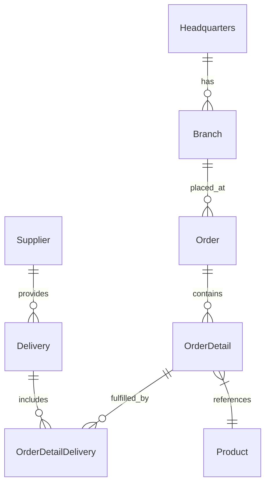

<a id="-octocat-supply-the-ultimate-github-copilot-demo-v370"></a>
# 🚀 OctoCAT Supply: 최고의 GitHub Copilot 데모 v3.7.0


OctoCAT Supply 웹사이트에 오신 것을 환영합니다! GitHub Copilot과 GHAS의 놀라운 기능, AI 지원 개발의 강력함을 보여 주는 데모입니다.

<a id="note-for-the-hands-on-demo-follow-the-step-by-step-instructions-in-zero-to-agents-hands-on-lab"></a>
## [!NOTE] 실습 데모는 [Zero-to-Agents 실습 랩](./demo/walkthroughs/general/demo-steps.md)의 단계별 지침을 따르세요.

> (선택 사항) 추가 데모는 [데모 가이드](./demo/walkthroughs/README.md)에서 확인할 수 있습니다.

<a id="-what-makes-this-demo-special"></a>
## ✨ 이 데모가 특별한 이유

이 앱은 단순한 데모가 아니라 GitHub의 AI 기능 전반을 보여 주도록 세심하게 구성한 쇼케이스입니다.

- 🤖 **Copilot Agent Mode & Vision** - Copilot이 UI 디자인을 이해하고 여러 파일에 걸쳐 복잡한 기능을 구현하는 모습을 확인하세요.
- 🎭 **MCP Server 통합** - Playwright 테스트와 GitHub API 통합으로 확장된 기능을 시연합니다.
- 🧪 **테스트 생성** - Copilot이 coverage를 분석하고 유의미한 테스트를 생성하는 기능을 보여 줍니다.
- 🔄 **CI/CD & IaC** - 자연어로 배포 workflow와 인프라 코드를 생성합니다.
- 🎯 **Custom Instructions** - Copilot이 내부 framework와 표준을 이해하도록 조정하는 방법을 보여 줍니다.
- 📜 **Custom Prompt 파일** - 반복 작업과 문서 업데이트를 간편하게 자동화합니다.

---

<a id="-architecture"></a>
## 🏗️ 아키텍처

이 애플리케이션은 관심사를 명확하게 분리한 현대적인 TypeScript로 구축되었습니다.



<a id="tech-stack"></a>
### 기술 스택

- **Frontend**: React 18+, TypeScript, Tailwind CSS, Vite

- **Backend**: Express.js, TypeScript, SQLite, OpenAPI/Swagger

- **데이터**: SQLite (`api/data/app.db`의 파일 DB, 테스트에는 in-memory 사용)
- **DevOps**: Docker

<a id="-getting-started"></a>
## 🚀 시작하기

<a id="prerequisites"></a>
### 사전 요구 사항


- Node.js 18+ 및 npm

- Make

<a id="quick-start"></a>
### 빠른 시작

1. 이 repository를 clone합니다.

2. 의존성을 설치합니다.

   ```bash
   make install
   ```

3. 개발 환경을 시작합니다.

   ```bash
   make dev
   ```

API 서버(port 3000)와 frontend 개발 서버(port 5173)가 모두 시작됩니다.

<a id="available-make-commands"></a>
### 사용 가능한 Make 명령어

사용 가능한 모든 명령어를 확인합니다.

```bash
make help
```

주요 명령어:

- `make dev` - API 및 frontend 개발 서버 모두 시작
- `make dev-api` - API 서버만 시작
- `make dev-frontend` - frontend 서버만 시작
- `make build` - production용 API 및 frontend 빌드
- `make db-init` - database schema 초기화
- `make db-seed` - database에 샘플 데이터 삽입
- `make test` - 모든 테스트 실행
- `make clean` - 빌드 산출물과 의존성 정리

<a id="database-management"></a>
### Database 관리

database를 명시적으로 초기화합니다(migration + seed).

```bash
make db-init
```

seed 데이터만 삽입합니다.

```bash
make db-seed
```


또는 API 디렉터리에서 npm script를 직접 사용합니다.

```bash
cd api && npm run db:migrate  # Run migrations only
cd api && npm run db:seed     # Seed data only
```


<a id="vs-code-integration"></a>
### VS Code 통합

VS Code task 및 launch 설정도 사용할 수 있습니다.

- `Cmd/Ctrl + Shift + P` -> `Run Task` -> `Build All`
- Debug 패널에서 `Start API & Frontend`를 실행합니다.

<a id="-mcp-server-setup-optional"></a>
## 🛠️ MCP Server 설정(선택 사항)

확장 기능을 시연하려면 다음을 진행합니다.

1. GitHub MCP server용 Docker/Podman을 설치합니다.
2. VS Code command palette를 사용합니다.
   - `MCP: List servers` -> `playwright` -> `Start server`
   - `MCP: List servers` -> `github` -> `Start server`
3. GitHub PAT로 설정합니다(GitHub MCP server에 필요).

<a id="-documentation"></a>
## 📚 문서

- [상세 아키텍처](./docs/architecture.md)
- [SQLite 통합](./docs/sqlite-integration.md)
- [전체 데모 스크립트](./demo/walkthroughs/README.md)

database 기본값 및 환경 변수:

- DB 파일: `api/data/app.db` (`DB_FILE=/absolute/path/to/file.db`로 재정의)
- WAL 활성화: `DB_ENABLE_WAL=true` (기본값)
- foreign key: `DB_FOREIGN_KEYS=true` (기본값)

---

*hero 이미지를 포함한 이 프로젝트 전체는 AI와 GitHub Copilot으로 만들었습니다! 이 README도 Copilot이 프로젝트 문서를 바탕으로 생성했습니다.* 🤖✨
