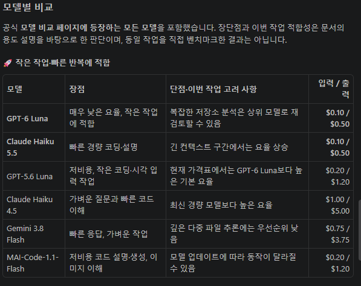
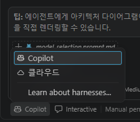
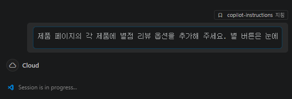
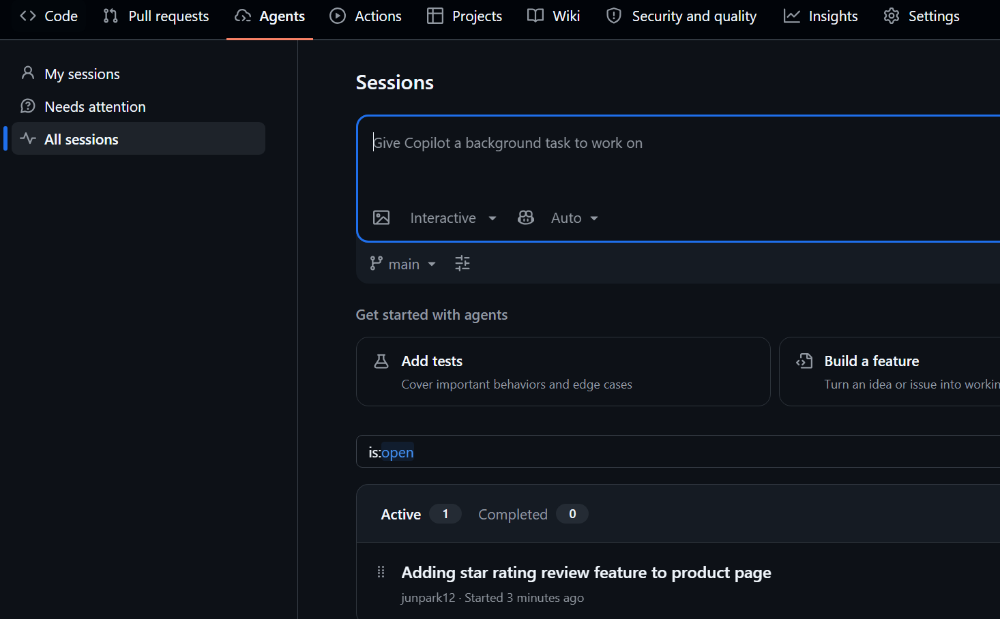
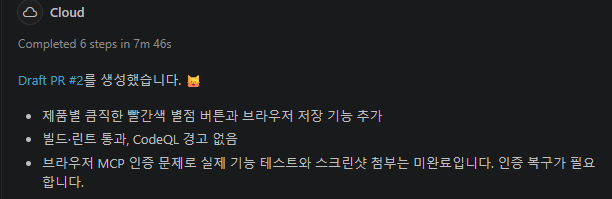
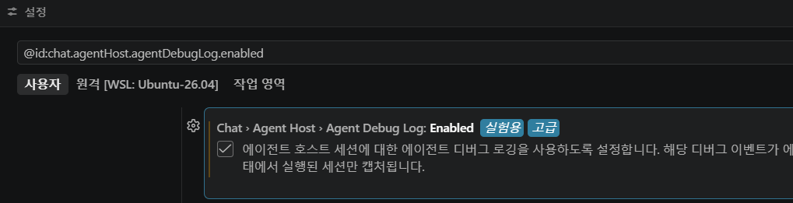
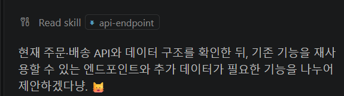
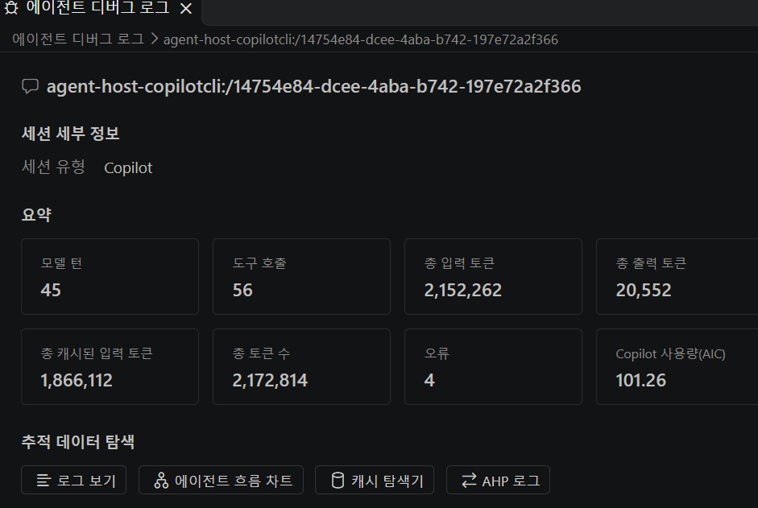
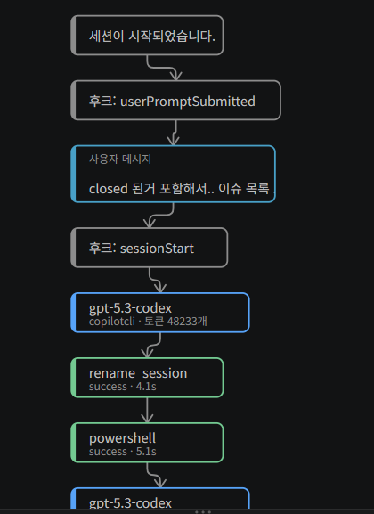

## 목차

1. [데모 1: Copilot 기초](#데모-1-copilot-기초)
2. [데모 2: Copilot Agent Mode](#데모-2-copilot-agent-mode)
3. [선택 사항: Copilot CLI](#선택-사항-copilot-cli)

---

## 데모 1: Copilot 기초

### 초기 설정: VS Code Workspace

---

### 프로젝트 개요

**[프롬프트]** `[Ask Mode]`
```
코드베이스를 검토하고 사용된 관련 프로그래밍 언어와 테스트 케이스를 포함하여 프로젝트를 설명해 주세요.
```

---

### 설치 및 실행

**[실행]** VS Code에서 터미널을 열고 `make install` 명령으로 의존성을 설치합니다

> **Windows:** 해당 디렉터리(예: `/api` 또는 `/frontend`)로 이동하여 `npm install`을 실행합니다

**[선택 사항]** `make dev`로 frontend를 실행합니다

---

### Inline Chat Completion 데모

**[실행]** 다음 파일을 열고 열린 상태로 유지합니다.
- `api/src/models/order.ts`
- `api/src/repositories/ordersRepo.ts`
- `api/src/routes/order.ts`

**[실행]** `ordersRepo.ts` 파일의 기존 async 메서드 사이에 다음 인라인 주석을 추가합니다(맨 끝이나 맨 앞에 추가하지 마세요).
```typescript
// Count orders by branch
```

**[프롬프트]** `[Agent Mode]`
```
방금 추가한 countByBranch의 조회 endpoint를 추가해 주세요. 해당 API 문서도 업데이트해 주세요. 아직 배포하거나 테스트하지 마세요
```

---

### 검증

Agent가 구현을 완료하면 `make dev`로 애플리케이션을 실행하고 새 endpoint를 보여 줍니다

**열기:** http://localhost:3000/api-docs
- Orders 섹션을 찾습니다
- `GET /api/orders/branch/{branchId}/count`를 찾습니다

---

## 데모 2: Copilot Agent Mode

### 심층 코드베이스 분석

**[프롬프트]** `[Agent Mode]`
```
이 #codebase를 매우 깊이 분석해 주세요. 프로젝트에서 사용되는 모든 프로그래밍 언어의 모범 사례를 포함하도록 .github/copilot-instructions.md 파일을 업데이트해 주세요. #fetch https://www.w3schools.com/typescript/typescript_best_practices.php
```

---

### 선택 사항: 사용자 지정 페르소나

**[선택 사항 - 실행]** 원하는 페르소나를 선택합니다. 예: James Bond, Elon Musk, Neil Armstrong. 아래 이름을 선택한 이름으로 바꿉니다. Agent가 지침 파일의 컨텍스트를 거의 즉시 파악하여 모든 세션에 적용하는 방식을 보여 주는 것이 목적입니다

**[선택 사항 - Copilot 지침 파일에 추가]**
```
당신은 코드계의 고양이입니다. 고양이 처럼 말하고 고양이 관련 이모지를 사용해 주세요.
```

---

### 코드 검토 

**[프롬프트]** `[Agent Mode]`
```
코드를 검토하고 업데이트된 copilot-instructions 파일의 모범 사례를 따르는지 확인해 주세요
```

---

### 프롬프트 파일

**[프롬프트]** `[Agent Mode]`
```
/model-selection Frontend 애플리케이션에 간단한 장바구니 아이콘과 장바구니 페이지를 추가하고 싶습니다. 아직 구현하지 마세요.
```

> **설명:** `/model-selection`은 `.github/prompts/model-selection.prompt.md`를 호출하며, 뒤의 문장은 모델 추천에 사용할 자연어 입력입니다. Frontend는 사용자에게 보이는 웹 화면을 뜻합니다. 이 단계는 기능 구현이 아니라 적합한 모델을 추천받는 요청이며, 실제 모델 선택을 자동으로 변경하지 않습니다.

**[출력 예시]**



> 2026-10-20 실행 결과의 일부입니다. 모델별 장단점과 작업 적합성은 생성된 비교이며, 직접 측정한 벤치마크가 아닙니다. 이미지의 모델명·요율은 실행 당시 출력으로, 공식 가격 정책이나 성능·SLA 보장이 아닙니다. 실제 지원 모델과 과금은 최신 공식 문서에서 확인하며, 결과는 모델·환경에 따라 달라질 수 있습니다.

---

### 애플리케이션 실행

**[애플리케이션 실행]** `make install` 명령으로 의존성을 설치합니다

> **Windows:** 해당 디렉터리(예: `/api` 또는 `/frontend`)로 이동하여 `npm install`을 실행합니다

**[선택 사항]** `make dev`를 실행하여 frontend를 확인합니다

---

### Agent 세션 데모

> **참고:** Cloud 및 background agent는 완료까지 몇 분이 걸립니다. 그동안 로컬 세션을 계속 진행하고 나중에 cloud 및 background 세션으로 돌아올 수 있습니다.

---

#### Cloud Agent 세션

**[사용 이유와 시나리오]** 요구사항과 완료 조건이 명확한 작업을 원격 환경에 맡기고, 개발자는 다른 작업을 진행한 뒤 PR로 결과를 검토할 때 사용합니다. 현재 로컬 코드와 도구를 보며 즉시 조정해야 하는 작업보다는, 저장소의 코드만으로 진행할 수 있는 독립적인 작업에 적합합니다.

| 시나리오 | Cloud Agent를 사용하는 이유 |
|---|---|
| 범위가 작은 기능 추가 또는 버그 수정 | 요구사항·재현 방법·인수 조건을 전달하고 구현 결과를 PR로 검토할 수 있습니다. |
| 테스트 보강·문서 개선·반복적인 코드 정리 | 별도로 진행하도록 맡겨 두고 개발자는 다른 업무를 이어갈 수 있습니다. |
| 여러 독립 작업의 병렬 진행 | 로컬에서 진행 중인 편집과 분리해 작업을 맡기고, 각각의 결과를 검토한 뒤 통합할 수 있습니다. |
| Issue에 정리된 작업 처리 | Issue의 요구사항을 바탕으로 구현·검증하고 PR의 변경 내용과 실행 기록을 검토하는 흐름으로 연결할 수 있습니다. |

> **이번 실습의 의도:** 별점 리뷰 기능을 Cloud에 맡긴 동안 로컬에서는 장바구니 등 다른 데모를 진행하고, 이후 돌아와 PR을 확인합니다. Cloud라고 모든 작업이 자동으로 성공하거나 안전해지는 것은 아닙니다. 필요한 의존성·실행 환경·권한을 준비하고 결과를 검토해야 하며, 로컬 전용 파일·미커밋 변경·로컬에서 실행 중인 서비스는 자동으로 제공되지 않습니다.

**[실행 위치 선택]** 새 채팅에서 첫 메시지를 보내기 전에 입력창 하단의 `Copilot` 메뉴를 열고 **`클라우드`**를 선택합니다. 대상 저장소가 `junpark12/octocat-supply`이고 원하는 원격 브랜치인지 확인한 뒤 아래 프롬프트를 실행합니다.



> **설명:** 앞선 로컬 코드 작업과 달리, 이 단계는 원격 저장소의 코드를 기준으로 Cloud Agent가 작업하고 PR로 결과를 제공하는 세션입니다. 로컬의 미커밋 변경은 자동으로 포함되지 않습니다. 단순히 프롬프트에 “클라우드에서 실행해”라고 쓰는 것과 실제 실행 대상을 선택하는 것은 다릅니다. 캡처는 2026-10-20 기준 실행 대상 선택 메뉴이며, Cloud 세션 시작·완료 결과를 보여주는 화면은 아닙니다.

**[프롬프트]** `[새 Cloud Agent 세션 생성]` 
```
제품 페이지의 각 제품에 별점 리뷰 옵션을 추가해 주세요. 별 버튼은 눈에 띄고 클릭하기 쉽게 만들어 주세요. 버튼 색상은 반드시 빨간색으로 해 주세요! 기능을 테스트하고 쉽게 검토할 수 있도록 PR에 별점 리뷰 기능의 스크린샷을 포함해 주세요.
```

**[실행 화면]**



> **설명:** `Cloud`와 `Session is in progress...` 표시로 Cloud 세션이 진행 중임을 확인합니다. 이 화면만으로 구현·테스트 완료를 판단하지 말고, 이후 세션 결과와 생성된 PR을 확인합니다.

**[GitHub 웹에서도 확인]** 대상 저장소의 **Agents → All sessions**에서 Cloud Agent 작업을 확인할 수 있습니다. 해당 세션을 열어 진행 상황과 실행 기록을 확인하고, 완료 후 연결된 PR을 검토합니다.



> **캡처 설명:** `Active 1`, `Completed 0`과 `Adding star rating review feature to product page` 작업이 표시됩니다. VS Code에서 요청한 작업을 GitHub 웹에서도 확인하는 예시이며, 아직 완료된 결과는 아닙니다.

**[작업 결과와 PR]**



> **설명:** Cloud Agent는 별도 작업 브랜치에 변경을 만들고 PR로 검토를 요청합니다. **Cloud 작업 → 작업 브랜치의 변경 → PR → 리뷰·Merge → 대상 브랜치 반영**의 흐름이며, PR 생성만으로 원격 `main`이나 현재 로컬 파일이 바뀌지는 않습니다. Merge 후 로컬 반영도 별도로 필요하며, 진행 중인 로컬 데모 변경을 먼저 보존해야 합니다.
>
> **이번 결과의 주의점:** 캡처에는 Draft PR #2와 빌드·린트 통과가 표시되지만, 브라우저 기능 테스트와 스크린샷 첨부는 미완료로 보고되어 있습니다. Agent의 완료 표시만으로 모든 요구사항이 충족됐다고 판단하지 말고, PR의 diff와 실제 검증 결과를 확인한 뒤 Merge 여부를 결정합니다.

---

#### Background Agent 세션

**[프롬프트]** `[Copilot CLI로 새 background agent 세션 생성]`
```
당신은 보안 엔지니어입니다. 코드를 심층 점검하여 CVE를 찾는 CVEFinder.prompt.md를 만들어 주세요. 또한 프롬프트는 다음 작업을 수행해야 합니다. 1) 취약점을 식별한 후 GiHub MCP 서버로 취약점별 Issue 생성 2) 수정을 위해 Issue를 copilot에 할당 3) 추가 지침 없이도 copilot coding agent에 할당하여 취약점을 수정할 수 있도록 Issue에 상세한 정보 포함.
```

---

### 사용자 지정 Agent 및 Subagent(Agent 오케스트레이션)

**참고:** 사용자 지정 agent를 호출하기 전에 Agent Debug Log Panel [설정](https://code.visualstudio.com/docs/agents/agent-troubleshooting/chat-debug-view#_agent-debug-log-panel)이 활성화되어 있는지 확인합니다. 이후 섹션에서 agent 로그를 검토합니다.

**[로그 수집 활성화 — Copilot / Agent Host 세션]** `Ctrl + ,`로 설정을 열고 `@id:chat.agentHost.agentDebugLog.enabled`를 검색한 뒤 체크합니다.



> **설명:** 위 캡처는 로그 수집 설정을 켠 화면입니다. 활성화한 뒤 사용자 지정 Agent를 실행하고, `Ctrl + Shift + P` → `Developer: Open Agent Debug Logs` 또는 Chat의 `…` → `Show Agent Debug Logs`에서 기록을 확인합니다. 활성화 이전 활동은 소급 수집되지 않습니다. Local harness는 별도 설정 `github.copilot.chat.agentDebugLog.fileLogging.enabled`를 사용하므로 실행 환경을 구분합니다. 로그에는 코드·프롬프트·경로 등이 포함될 수 있으므로 공유 전 확인합니다.

**[프롬프트]** `[accessibility-report 사용자 지정 agent 사용]`
```
접근성 보고서를 생성해 주세요
```

> **참고:** 로컬 agent가 장바구니 기능을 구현하면서 생성한 GitHub Issue를 살펴봅니다. Cloud agent와 background agent의 결과도 검토합니다

---

### Plan Mode 및 Issue 생성

---

#### 장바구니 구현 계획(Copilot Vision 사용)

**[프롬프트]** `[Plan Mode]` (Chat에 `/docs/design/cart.png` 이미지 첨부)
```
Navbar에 장바구니 아이콘이 있는 간단한 장바구니 페이지 구현 계획을 작성해 주세요. 제품을 장바구니에 추가하면 navbar에 장바구니 항목 수가 표시되어야 합니다. 지금은 할인 옵션을 포함하지 마세요. 구현 단계는 간단하고 최소한으로 유지해 주세요. 단위 테스트는 건너뛰세요.
```

> **참고:** Agent가 계획을 완료하면 검토한 후 Agent 모드를 선택하거나 "Start Implementation" 인계 옵션으로 agent에 넘깁니다.

---

#### GitHub Issue 통합

**[프롬프트]** `[Default Agent]`
```
구현 작업을 추적할 Issue를 저장소에 생성해 주세요. 체크리스트로 만들어 주세요.
```

**[프롬프트]** `[Default Agent]`
```
방금 생성한 Issue를 검토하고 장바구니 기능 구현의 예상 일정을 알려 주세요
```

**[프롬프트]** `[Default Agent]`
```
변경 사항을 구현해 주세요. 각 단계를 완료할 때마다 GitHub Issue에 진행 상황을 댓글로 남겨 주세요. 변경된 파일을 저장소에 commit하지 마세요.
```

---

### Agent Skills(api-endpoint skill)

**[프롬프트]**
```
주문 현황 파악과 추적을 개선할 API endpoint 추가 방안을 제안해 주세요
```

**[Skill 사용 확인]**



> **설명:** `Read skill api-endpoint` 표시로 Agent가 해당 Skill을 읽은 것을 확인합니다. 이 화면은 Skill 로딩을 보여주며, API 구현이나 검증까지 완료됐다는 뜻은 아닙니다.

> **참고:** Agent의 제안에서 옵션 하나를 선택하여(order statistics를 대체) 구현합니다

**[프롬프트]**
```
주문 통계 endpoint를 구현해 주세요
```

Agentic skills로 구현한 새 API endpoint를 확인합니다

---

### Agent Hooks

이 시점에는 Hooks 정의로 여러 agent 세션 감사 로그가 이미 생성되어 있어야 합니다. 아래 단계를 따라 로그 파일로 이동합니다. 로그가 없다면 새 agent 세션을 시작하고 중단 없이 완료될 때까지 기다려 hook이 세션 시작 및 종료 감사 로그를 모두 생성하도록 할 수 있습니다.

**[작동 방식]**
- Hook은 `.github/hooks/hooks.json` 정의로 agent 동작을 사용자 지정할 수 있게 합니다
- `session-start-audit.sh` 스크립트는 agent 세션 시작 전 브랜치와 commit 기록을 추적할 기준 스냅샷을 만듭니다
- `session-stop-audit.sh` 스크립트는 agent가 수정/생성한 파일, 생성한 commit, 세션 시간을 추적합니다
- Hook은 `.agent-audit/{sessionID}` 디렉터리에 세션 시작 및 종료 로그를 저장합니다. 

---

### Agent 디버그 로그 / 흐름도

**참고:** 보고서 생성 세션의 agent 디버그 로그를 보려면 위의 사용자 지정 Agent 및 Subagent 섹션을 완료해야 합니다. 다른 세션의 agent 디버그 로그/흐름도는 여전히 볼 수 있습니다.

Agent Debug Log 패널은 agent 워크플로 문제 해결, 모델 선택 이해, Chat 세션 중 agent 상호 작용의 시간순 이벤트 로그 확인을 위한 강력한 도구입니다. 특히 사용자 지정 agent와 오케스트레이션된 subagent 워크플로를 디버깅할 때 유용합니다.

1) [여기](https://code.visualstudio.com/docs/agents/agent-troubleshooting/chat-debug-view#_agent-debug-log-panel)의 지침에 따라 Agent Debug Log Panel을 엽니다
2) 기본적으로 패널에는 [Tree View](https://code.visualstudio.com/docs/agents/agent-troubleshooting/chat-debug-view#_logs-view)가 표시됩니다. `Agent Debug Logs > Report Generation Request > Logs`의 트리 맨 위를 클릭하여 [Summary 보기](https://code.visualstudio.com/docs/agents/agent-troubleshooting/chat-debug-view#_summary-view)로 전환합니다
3) 사용자 지정 agent 및 subagent 호출이 표시된 해당 세션을 선택합니다
4) Agent Flow Chart를 선택하여 도구 호출, 모델 선택, 사용자 메시지, agent 응답이 표시된 subagent 워크플로를 확인합니다

**[Summary 확인 예시]**



> **실습 중 관찰:** 현재 환경에서는 Chat의 실행 결과가 Debug Logs에 즉시 반영되지 않는 현상이 있었고, 이전 세션의 로그도 표시되었습니다. 패널에는 현재·과거 세션이 함께 나타날 수 있으므로 세션 이름·시각을 확인해 원하는 기록을 선택합니다. 이는 이번 환경에서의 관찰이며, 공식적으로 실시간 갱신을 지원하지 않는다는 뜻이나 일정한 지연 시간이 보장된다는 뜻은 아닙니다. 표시 지표가 0이라는 이유만으로 Agent가 실행되지 않았다고 판단하지 않습니다.

**[Agent Flow Chart 예시]**



> **설명:** 선택한 세션의 Hook 이벤트, 사용자 메시지, 모델 요청과 도구 호출 흐름을 확인하는 예시입니다. 캡처에는 `rename_session`, `powershell` 호출과 성공 상태·소요 시간이 보입니다. 이 이미지 자체는 subagent 위임을 보여주는 증거는 아니며, subagent 실행을 확인하려면 해당 위임이 발생한 세션의 호출·하위 작업 노드를 확인해야 합니다. 로그·캡처를 공유하기 전 프롬프트·코드·경로 등 민감정보가 포함되어 있는지 검토합니다.

---

## 선택 사항: Copilot CLI

### Space Invaders 게임 데모

**참고:** 독립 실행형 터미널이나 VS Code 터미널에서 Copilot CLI를 실행합니다. 프롬프트가 Azure MCP 서버로 게임을 Azure Web App에 배포하므로 프롬프트 실행 전에 Azure MCP 서버가 실행 중이어야 합니다.

**[프롬프트]**
```
반짝이는 별 객체가 "침략자"이고 대포가 로켓인 Space Invaders 스타일 미니 게임을 만들기 위한 requirement.md를 작성해 주세요. 임무는 별들을 쏘아 물리치고 한밤의 공세에서 살아남으며 각 웨이브를 완료할 때 축하 불꽃놀이를 터뜨리는 것입니다. 가볍지만 창의적으로 만들고 빠르게 배포해 주세요. 단일 Azure Web App으로 게시하여 브라우저에서 플레이할 수 있게 해 주세요. 해당 모델로 앱을 만들었다고 자랑스럽게 말할 수 있도록 앱 안에 모델 이름을 넣어 주세요.
```

> **참고:** 이 프롬프트는 게임 빌드와 배포 전에 requirements.md 파일을 생성하므로 입력에 주의를 기울이고 agent가 작업을 완료하는 데 필요한 도구를 허용하세요.

---
