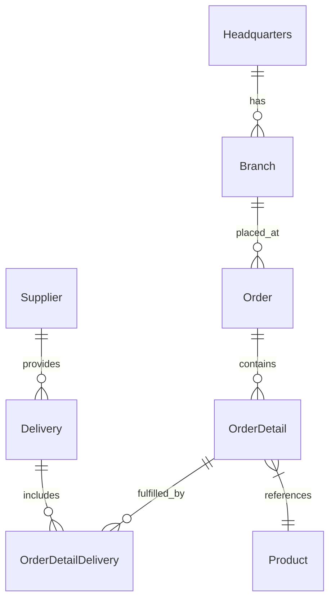
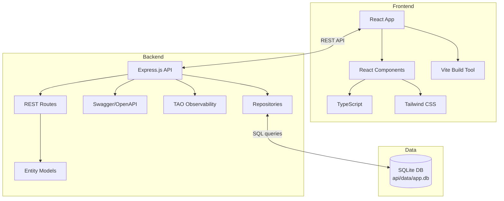

# OctoCAT 공급망 관리 시스템 아키텍처

이 사이트는 TypeScript로 작성한 데모 애플리케이션입니다. 앱 전체는 처음에 Copilot을 사용하여 [ERD 다이어그램](../api/ERD.png)과 자연어 prompt로 만들었습니다. frontend도 같은 방식으로 [디자인 폴더](./design/)의 디자인 아이디어 일부를 활용하여 만들었습니다.

hero 이미지와 제품 이미지는 ChatGPT에 prompt를 입력하여 만들었습니다!

## 아키텍처 개요

이 시스템은 TypeScript로 구축한 현대적인 공급망 관리 애플리케이션으로, backend REST API와 React frontend로 구성됩니다. 비교적 일반적인 아키텍처에 약간의 복잡성을 더해 Copilot 기능을 보여 주도록 설계했지만, 데모 진행을 방해할 정도로 복잡하지는 않습니다!

### Backend 아키텍처
- 모든 entity에 RESTful endpoint를 제공하는 Express.js API
- 경량 repository pattern을 사용하는 SQLite persistence
- SQL 파일로 관리하는 schema migration 및 seed 데이터
- Swagger/OpenAPI 문서 통합
- ERD 다이어그램에 따라 적절한 관계를 갖춘 entity model

### Frontend 아키텍처
- TypeScript를 사용하는 React 18+
- 빠른 개발을 위한 Vite 빌드 도구
- UI 스타일링용 Tailwind CSS

### DevOps 통합
- container화를 위한 Docker/Docker Compose
- Azure 배포를 위한 선택적 Bicep + GitHub Actions 계획

## ERD

## Component 아키텍처

## 주요 기능

- 모든 공급망 entity에 대한 완전한 REST API
- foreign key와 indexed query를 사용하는 SQLite 기반 persistence
- 선언적 migration(docs/sql/migrations)과 결정적인 seed 데이터
- Copilot이 생성한 상세 OpenAPI 문서
- Copilot이 이미지를 활용해 생성한 responsive design 기반의 현대적인 React UI
- Copilot이 생성한 일관된 배포용 container화 구성

## Persistence 및 데이터 model

- Database: SQLite (기본 파일 위치는 `api/data/app.db`, `DB_FILE`로 설정 가능)

- 접근: camelCase model을 snake_case column에 매핑하는 얇은 repository 계층

- Migration: `api/sql/migrations`의 SQL script를 순서대로 실행하고 `migrations` table에서 추적
- Seeding: `api/sql/seed`의 순서가 지정된 SQL script로 데모 데이터 초기 구성
- 테스트 모드: 빠르고 격리된 테스트를 위한 in-memory database (`:memory:`)

전용 가이드를 참고하세요: `docs/sqlite-integration.md`.
